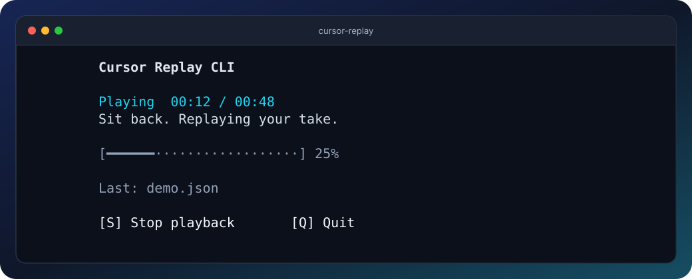
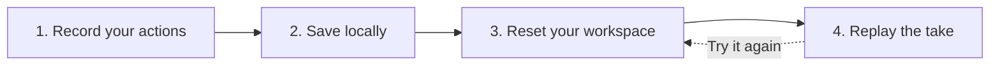

<div align="center">

# Cursor Replay CLI

**Record your mouse. Replay your workflow.**

Repeat clicks, drags, and scrolling in your macOS apps.<br>
A native terminal app. Local recordings. No cloud service.

[](#where-it-works)
[](#install)
[](LICENSE)

[Install](#install) · [Open the app](#open-the-app) · [Usage guide](docs/USAGE.md) · [Developer guide](DEVELOPMENT.md)



<sub>Rendered from the app with an example take. Runs in your terminal, not a separate desktop window.</sub>

</div>

Repeat a product walkthrough, revisit a scrolling interaction, or reproduce a
mouse-driven UI issue without performing every gesture again.

## From gestures to another take



Capture movement, clicks, drags, and mouse or trackpad scrolling with their
recorded timing and pauses. Replay a take, change its speed, or loop it from the CLI.
Recordings are local JSON files. No third-party runtime dependencies.

## Where it works

| Environment | Scope |
| --- | --- |
| **System** | macOS 15+ in your logged-in desktop session. Not Windows or Linux. |
| **Interface** | Terminal or a local integrated terminal. A CLI, not a desktop `.app`. |
| **Target** | Mouse-driven interactions in macOS apps and browser windows, not one specific editor. |
| **Not included** | Typing capture, video recording, UI-element recognition, or automatic app launching. |

> [!IMPORTANT]
> Replay sends **real mouse input at recorded screen coordinates**. Restore the
> app state and display layout yourself, and start with a disposable document.
> The same event stream does not guarantee identical app behavior.

## Install

Requires **Swift 6+** through Apple's Command Line Tools or Xcode 16+.
If needed, install the tools with `xcode-select --install`.

Install the stable release through this project's Homebrew tap:

```sh
brew tap Just-Jan/cursor-replay-cli https://github.com/Just-Jan/cursor-replay-cli
brew install Just-Jan/cursor-replay-cli/cursor-replay
cursor-replay doctor
```

Homebrew makes `cursor-replay` available on its normal `PATH`.
Prefer a local build? See [installation from source](docs/USAGE.md#build-and-run).

In **System Settings > Privacy & Security**, grant **Accessibility** and
**Input Monitoring** to the app hosting your terminal. If macOS lists the
executable itself, enable that entry as appropriate. Restart the terminal if
needed and rerun `doctor`. [Permission details](docs/USAGE.md#grant-permissions).

## Open the app

From **any folder**, open Terminal and run:

```sh
cursor-replay
```

Use a **hyphen**, not `cursor replay`. The interactive menu opens in that terminal;
installation does not add an Applications or Spotlight icon.

1. Press **R** and switch to your app during the three-second countdown.
2. Perform your actions, then press **Esc** to stop and save.
3. Wait for the save confirmation, then reset your app to its starting state.
4. Press **P** in the terminal and switch back during the countdown.

**S** also stops, but needs terminal focus. **Q** or **Ctrl+C** quits, saving an
active recording first. Esc is listen-only: the target app receives it too.

Menu recordings live in `~/Library/Application Support/Cursor Replay CLI/recordings`.
Treat captures as private interaction data, not public fixtures.

## Beyond the menu

Use `record`, `play`, `info`, and `verify` in scripts. For example,
`cursor-replay play demo.json --speed 0.5 --loop 3` replays a take at half speed
three times. [Command reference](docs/USAGE.md#command-line-reference).

[Upgrade or uninstall](docs/USAGE.md#install-with-homebrew) ·
[Troubleshooting](docs/USAGE.md#troubleshooting) ·
[Report an issue](https://github.com/Just-Jan/cursor-replay-cli/issues)
