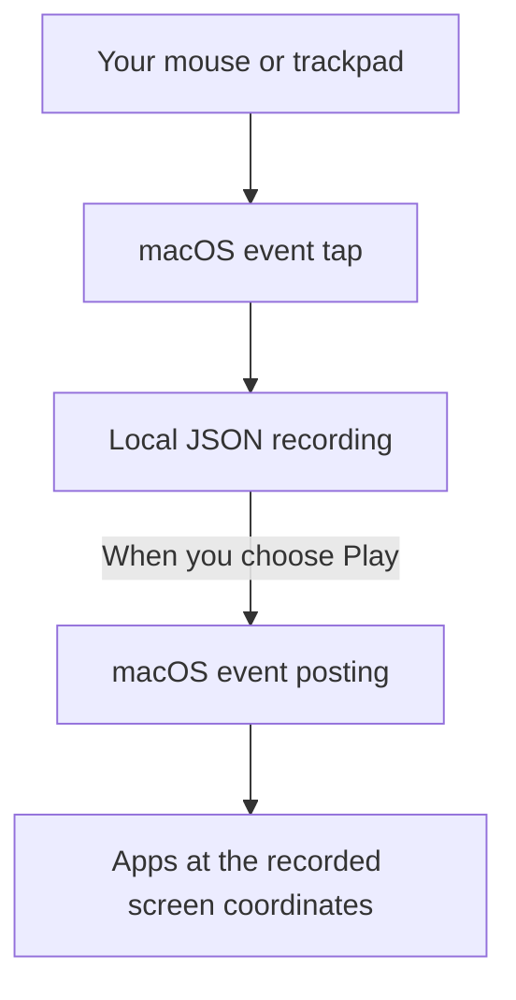

# Cursor Replay CLI usage guide

[Overview](../README.md) · [Installation](#install-with-homebrew) ·
[Permissions](#grant-permissions) · [Menu](#one-small-terminal-screen) ·
[Commands](#command-line-reference) · [Troubleshooting](#troubleshooting)

## How it works

Cursor Replay CLI records and posts native macOS mouse events. It is not a
screen recorder, browser extension, or UI-element automation framework. The
terminal controls capture and replay; you choose and reset the target app.



Movement, clicks, double clicks, button-held drags, and scrolling are captured,
including trackpad deltas, scroll phases, and recorded momentum. Captured event
coordinates and full-session timing include leading and trailing pauses; replay
does not interpolate movement. Modifier flags accompany mouse events, but general
keyboard input is not recorded or replayed. There is no runtime dependency on
`cliclick` or `osascript`.

Preserving events is not a promise of identical target-app behavior. macOS
delivery latency, coalescing, app state, and display changes can affect replay.
Use `verify` to measure the event stream, not to certify hardware equivalence.

## Install with Homebrew

Requires **macOS 15+** and Apple's **Swift 6+ Command Line Tools** or Xcode 16+.
This is a source-built formula: Homebrew compiles a native executable on your Mac;
there are no prebuilt bottles or third-party runtime dependencies.

Install the stable release through this repository's Homebrew tap:

```sh
xcode-select --install # only if Command Line Tools are not already installed
brew tap Just-Jan/cursor-replay-cli https://github.com/Just-Jan/cursor-replay-cli
brew install Just-Jan/cursor-replay-cli/cursor-replay
cursor-replay --version
cursor-replay doctor
```

The explicit tap URL is required because this repository is not named
`homebrew-cursor-replay-cli`. No separate tap repository is needed. This is a
CLI formula, not a `.app` bundle or a `brew install --cask` package, and it is
not part of Homebrew's official core repository.

You can opt into an unreleased build with
`brew install --HEAD Just-Jan/cursor-replay-cli/cursor-replay`.
HEAD builds report the source's development version, not a stable release
guarantee. For release maintenance, see [publishing a release](../DEVELOPMENT.md#publishing-a-release).

```sh
brew update
brew upgrade Just-Jan/cursor-replay-cli/cursor-replay
brew uninstall cursor-replay
# Optional, after uninstalling:
brew untap Just-Jan/cursor-replay-cli
```

Homebrew does not grant macOS permissions. Follow [Grant permissions](#grant-permissions)
after installation and rerun `doctor` after an upgrade if permissions stop working.
Upgrades and uninstalling leave your recordings untouched. If you previously used
the manual installer below, remove its old `~/.local/bin/cursor-replay` after
confirming the Homebrew executable works, so `PATH` does not select a stale copy.

## Build and run

Requires **macOS 15+**, **Swift 6+**, and Apple Command Line Tools or Xcode.
There are no third-party package dependencies. Install Command Line Tools with
`xcode-select --install` if needed.

From the unpacked `cursor-replay-cli` source folder:

```sh
./scripts/build.sh
./bin/cursor-replay --help
./bin/cursor-replay doctor
./bin/cursor-replay
```

The build script uses a release build, keeps SwiftPM output in
`~/Library/Caches/cursor-replay-cli/swiftpm`, and copies the executable to
`./bin/cursor-replay`. Override the build cache with `CURSOR_REPLAY_BUILD_DIR`.
The generated `bin/` folder is not source and is ignored by Git.

Optional user-level installation:

```sh
./scripts/install.sh
export PATH="$HOME/.local/bin:$PATH"
cursor-replay --help
```

The installer builds first, then installs `~/.local/bin/cursor-replay`. It does
not change `PATH` or shell configuration. Add the export to your shell
configuration yourself if needed (`~/.zshrc` for the default macOS shell), or
invoke the installed executable by its full path. Once installed and on `PATH`,
run `cursor-replay` from any folder to open the interactive menu in that terminal.
The command uses a hyphen, not a space; installation does not create an app in
Applications or a Spotlight launcher. Reinstall after rebuilding and quit old
running instances.
To uninstall, remove `~/.local/bin/cursor-replay`; captures remain untouched.

Use compiled executables, not `swift SomeFile.swift`. Local builds target the
Mac's native architecture, not a universal binary. The Homebrew formula builds
from the same source on Apple Silicon or Intel; CI is configured for both.
Release automation requires source builds and Homebrew installation checks on
macOS 15 Apple Silicon and Intel before publishing. Those checks do not certify
permissions or physical replay behavior on every Mac.
Keep source and build caches outside cloud sync, whose file policies can reject
generated signing artifacts.

## Grant permissions

Run `cursor-replay doctor`, or `./bin/cursor-replay doctor` before installation.
In **System Settings > Privacy & Security**, grant the missing permissions to
the app hosting your terminal, such as Terminal or your integrated terminal's
host:

| Check | Setting |
| --- | --- |
| Accessibility | Privacy & Security > Accessibility |
| Input Monitoring | Privacy & Security > Input Monitoring |
| Post Event Access | Normally controlled through Accessibility |

These are terminal-based grants, not a target-app selector. If macOS lists the
executable itself, enable that entry as appropriate. Fully quit and reopen the
terminal if grants are not recognized, then rerun `doctor` using the same
executable path. On managed Macs, ask IT about locked settings.

`doctor` checks permissions and displays; it does not post input or prove replay
works. Grant these broad permissions only to code you trust.

## One small terminal screen

Run `cursor-replay` with no arguments, or `cursor-replay menu`. The interactive
menu requires a real terminal. It uses one compact alternate-screen view with
a subtle one-second recording pulse, elapsed time, playback progress, and one
friendly current message, rather than a scrolling log wall.

No Enter is needed. Uppercase and lowercase letters both work.

| Key | Action |
| --- | --- |
| **R** | Record after a three-second countdown |
| **S** | Stop and save recording, or stop playback |
| **P** | Play the last saved recording after a three-second countdown |
| **Q** or **Ctrl+C** | Quit, saving an active recording first |
| **Esc** | Alternative stop during recording or playback |

There are no numeric aliases or mouse-clickable buttons. **S needs terminal
focus.** Esc is observed globally during an active operation and is listen-only,
so the target app also receives it. S or Esc during countdown cancels without
creating a recording. Q or Ctrl+C exits.

1. Press **R** and switch to your target app during the countdown.
2. Perform the mouse actions, then press **Esc**, or return here and press **S**.
3. Wait for confirmation that the file was saved. Reset the target app's state.
4. Press **P** and switch back during the countdown. Repeat with **P** or start
   another recording with **R**.

The tool never selects, launches, or restores a target app. Replay triggers real
input at recorded screen coordinates. Begin with a disposable document or other
non-destructive target.

`NO_COLOR` disables color; `TERM=dumb` uses a simpler presentation. Terminal
settings and cursor visibility are restored on controlled exit. Forced
termination cannot guarantee restoration or held-input cleanup.

## Captures stay outside the source tree

New menu captures get unique filenames in:

```text
~/Library/Application Support/Cursor Replay CLI/recordings
```

`CURSOR_REPLAY_DATA_DIR` overrides the **base directory**, with `recordings/`
appended. It must be a nonempty absolute path:

```sh
CURSOR_REPLAY_DATA_DIR="$HOME/CursorReplayData" cursor-replay
```

The menu selects the most recently modified recording across that folder and
legacy `./recordings/`, `./recording.json`, and `./movement.json` locations.
It excludes `.verification.json` reports. Discovery does not rewrite old files.

Direct `record`, `play`, `info`, and `verify` commands retain **current working
directory** semantics and default to `./recording.json`. `verify` writes
`<name>.verification.json` beside its input. Existing output files require
`--overwrite`. Empty captures can be saved with a warning but cannot be played.

Format **3** is inspectable JSON with a Base64 native event snapshot. Captures
can expose interaction patterns, screen locations, modifier states, and native
metadata. Treat recordings and verification reports as private local data, not
source files or public fixtures. Keep them outside the source folder.

## Command-line reference

Examples assume installation on `PATH`; otherwise use the full path to your
built `bin/cursor-replay` executable.

```text
cursor-replay
cursor-replay menu
cursor-replay record [-o file.json] [--countdown 3] [--duration seconds] [--overwrite]
cursor-replay play [file.json] [--countdown 3] [--speed 1.0] [--loop N]
cursor-replay info [file.json]
cursor-replay verify [file.json] [--countdown 3] [--overwrite]
cursor-replay doctor
cursor-replay --help
cursor-replay --version
```

```sh
mkdir -p "$HOME/CursorReplaySessions"
cd "$HOME/CursorReplaySessions"
cursor-replay record -o demo.json --duration 30
cursor-replay info demo.json
cursor-replay play demo.json --countdown 5 --speed 0.5 --loop 3
cursor-replay verify demo.json
```

Use a private session folder like this for direct commands, not the source tree.

`--countdown` is a nonnegative whole number of seconds, default `3`.
`--duration` is a positive recording limit after countdown. `--speed` is a
positive multiplier, default exactly `1.0`; `0.5` is slower. `--loop` is a
positive repetition count, default `1`. `-o` and `--output` select the recording
output path.

Direct commands do not have S-to-stop menu controls. Use Ctrl+C or Esc to stop
and save a direct recording, or to stop direct playback.
`info` reports event counts, event-span and full-session durations, displays,
sampling intervals, and warnings. Older files may lack surrounding idle time;
it cannot be recovered exactly. Playback reports planned versus elapsed time,
with a minimum one-millisecond loop span for extremely short timelines.

## Measure, do not assume, fidelity

`cursor-replay verify demo.json` **posts real input** and captures it through
the event tap. Reset the target app first and keep physical mouse/trackpad input
idle after the countdown. Verification uses speed `1.0`, one pass, and unique
event tags.

It compares counts, missing/duplicate tags, order, positions, known click/scroll
fields, all three axes of scroll deltas, and submission, event-timestamp, and
callback-arrival timing. Reports include maximum, mean, and p95 errors.

Strict verification fails on payload/position differences, timing over 2 ms,
capture interruptions, interfering input, or extra safety cleanup. Missing data
is not a successful zero-error result. Raw OS flag differences remain visible
even when public modifier-key flags match. A passing HID comparison still does
not prove identical rendering, scrolling, or private native metadata.

| Exit status | Meaning |
| --- | --- |
| `0` | Command succeeded, or strict verification passed |
| `1` | Argument, permission, file, capture-health, or other operational error |
| `2` | Verification failed or was inconclusive |
| `130` | Playback/verification cancellation, or Ctrl+C/SIGTERM menu exit |

A stopped direct recording normally returns `0` after saving successfully.
See [historical evidence and limits](../DEVELOPMENT.md#validation-evidence-and-known-limits).
The new presentation and automated results are not a fresh physical
trajectory, scroll, or click fidelity certification.

## Troubleshooting

| Symptom | Check |
| --- | --- |
| Permissions missing | Check both Accessibility and Input Monitoring for the terminal host, restart it, and rerun `doctor`. |
| Replay shorter than expected | Compare event-span and session duration in `info`; make a new capture if an old file lacks boundaries. |
| Initial cursor jump or display warning | Coordinates are absolute, not remapped or Retina-rescaled. Restore the original display layout or record again. |
| No events to replay | Confirm movement happened after the countdown. |
| File exists | Choose a new path or explicitly use `--overwrite`. |
| Menu unavailable in a pipeline | Use an explicit command or `--help`. |
| Terminal left in an unusual state after a forced kill | Run `stty sane`, then Enter. This restores conventional settings, not every prior customization. |
| macOS blocks a downloaded binary | Build locally and follow software approval rules; do not disable system protections. |

Controlled stops attempt matching mouse-up and zero-delta scroll/momentum
endings. Crashes, SIGKILL, shutdown, or revoked permissions cannot guarantee
cleanup delivery.

## Share source safely

Prefer sharing source so the recipient can build locally. From the source root,
this explicit allowlist includes the license and documentation:

```sh
COPYFILE_DISABLE=1 tar --exclude='.DS_Store' --exclude='._*' \
  -czf cursor-replay-cli-source.tar.gz \
  Package.swift Sources Tests scripts Formula docs .github README.md DEVELOPMENT.md LICENSE .gitignore
```

Do not archive the entire working folder. Exclude compiled binaries, `bin/`,
`.build/`, `.swiftpm/`, caches, Finder metadata, recordings, and verification
reports. `.gitignore` does not filter a manually created archive.

The project is [Just-Jan/cursor-replay-cli](https://github.com/Just-Jan/cursor-replay-cli)
and is licensed under [MIT](../LICENSE). Homebrew builds locally from checksummed
source; Developer ID signing, notarization, prebuilt/universal binaries, and a
desktop installer are not configured. Recipients still need their own permission
grants. Never disable system protections to run a downloaded executable.

[CI](../.github/workflows/ci.yml) runs tests, release builds, packaging checks, and
real Homebrew installation tests on macOS 15 Apple Silicon and Intel.
[Release automation](../.github/workflows/release.yml) publishes source archives,
checksums, and the stable formula when a matching `vX.Y.Z` tag is pushed.
See the repository's [Actions](https://github.com/Just-Jan/cursor-replay-cli/actions)
and [Releases](https://github.com/Just-Jan/cursor-replay-cli/releases) for current
run results and published versions.

For architecture, tests, timing lessons, format compatibility, and release
checks, continue with [DEVELOPMENT.md](../DEVELOPMENT.md).
